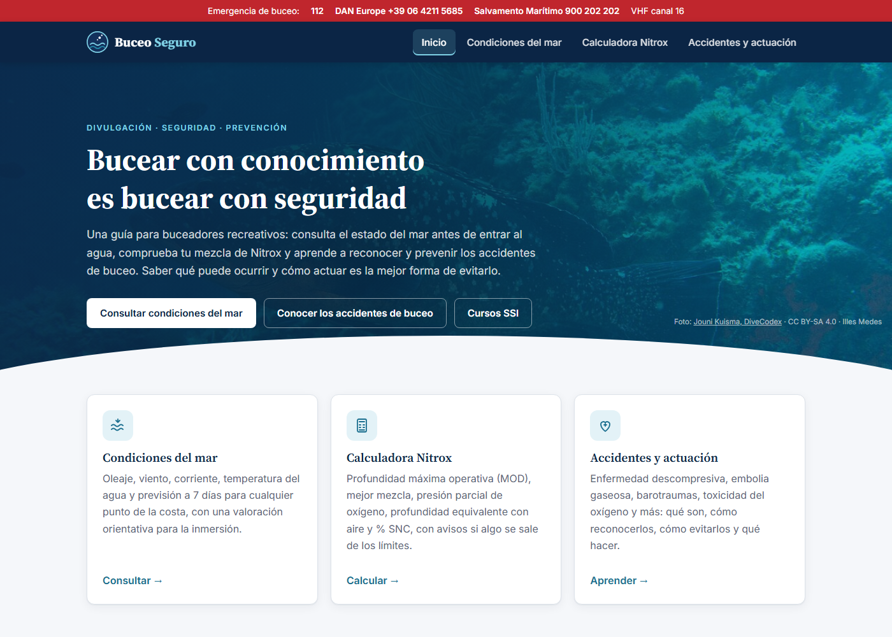
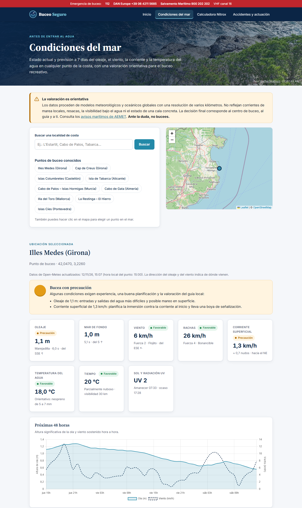
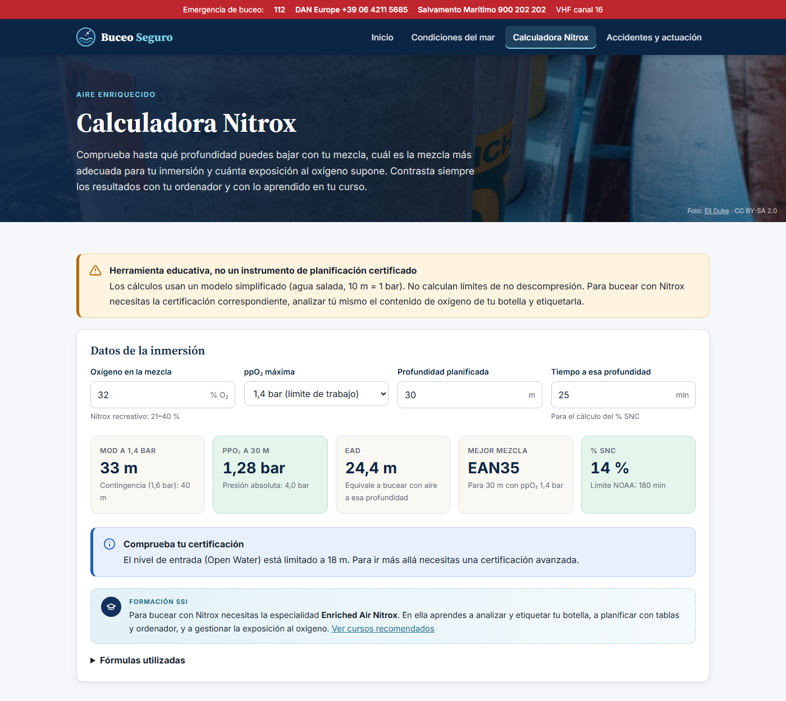
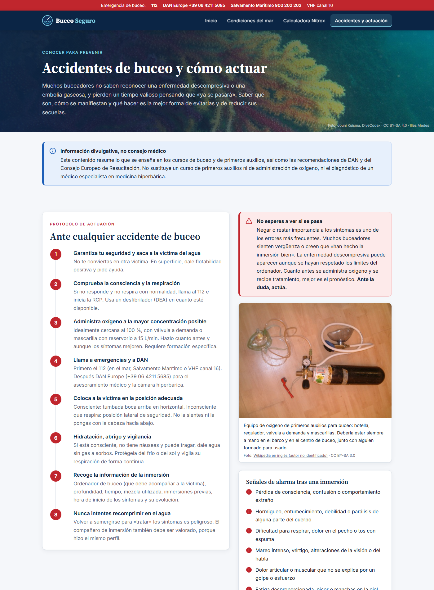

# 🤿 Buceo Seguro

Web divulgativa sobre **seguridad en el buceo recreativo**. Sirve para aprender, concienciar y planificar: consultar el estado del mar antes de una inmersión, calcular mezclas de Nitrox y conocer los accidentes de buceo, cómo prevenirlos y cómo actuar ante ellos.

Contenido elaborado por **John Quispe Carrió, instructor de buceo SSI**.



## ✨ Secciones

### 🌊 Condiciones del mar
- Búsqueda de localidades, puntos de buceo conocidos de España y selección de cualquier punto en un **mapa** (Leaflet).
- Datos en tiempo real: **oleaje** (escala Douglas), mar de fondo, **viento y rachas** (escala Beaufort), **corriente superficial**, **temperatura del agua** con un traje orientativo, tiempo, visibilidad, índice UV, amanecer y ocaso.
- **Valoración tipo semáforo** con los motivos detallados, según criterios publicados en la propia página.
- **Gráfico de las próximas 48 horas** (Chart.js) y **previsión a 7 días** con una valoración diaria.



### 🧮 Calculadora Nitrox
- MOD, MOD de contingencia, ppO₂ a la profundidad planificada, EAD, mejor mezcla y % SNC (límites de NOAA), calculados al momento mientras escribes.
- Avisos de seguridad automáticos: profundidad por encima de la MOD, ppO₂ superior a 1,4 o 1,6 bar, límites de la certificación y límite recreativo de 40 m.



### 🚑 Accidentes y actuación
- **Protocolo de actuación** en 8 pasos, señales de alarma y factores de riesgo de la enfermedad descompresiva.
- **16 fichas** con qué es, por qué ocurre, síntomas, prevención y cómo actuar: enfermedad descompresiva, embolia gaseosa arterial, neumotórax, barotraumas, narcosis, toxicidad del oxígeno, hipercapnia, monóxido de carbono, pánico y ahogamiento, quedarse sin aire, hipotermia, edema pulmonar por inmersión, problemas cardíacos y lesiones por vida marina.
- Filtro por tipo, enlaces directos a cada ficha (por ejemplo `accidentes.html#embolia`) y una versión para imprimir.



### 🎓 Formación SSI
- Una sección en el inicio con los cursos de SSI que más ayudan a bucear con seguridad: Enriched Air Nitrox, Navigation, Perfect Buoyancy, Deep Diving, Stress & Rescue y React Right, además del itinerario hasta Master Diver.
- Recomendaciones discretas en contexto: Enriched Air Nitrox en la calculadora, Waves, Tides & Currents en las condiciones del mar, y React Right y Stress & Rescue en la guía de accidentes.

### ☎️ Siempre a mano
Una barra de emergencia en todas las páginas con el **112**, **DAN Europe** (+39 06 4211 5685) y **Salvamento Marítimo** (900 202 202, VHF canal 16).

## 🛠️ Tecnologías

| Tecnología | Uso |
| --- | --- |
| HTML5 semántico, CSS3 (variables, grid, responsive), JavaScript ES6+ | Sin frameworks ni proceso de compilación |
| [Open-Meteo](https://open-meteo.com) (Marine, Forecast y Geocoding APIs) | Datos del mar y del tiempo, gratuitos y sin clave |
| [Leaflet](https://leafletjs.com) + [OpenStreetMap](https://www.openstreetmap.org) | Mapa interactivo |
| [Chart.js](https://www.chartjs.org) | Gráfico de oleaje y viento |

Accesibilidad: navegación por teclado, pestañas con roles ARIA, enlace para saltar al contenido, textos alternativos, contraste suficiente y respeto a `prefers-reduced-motion`.

## 📐 Fórmulas de la calculadora

```text
P (bar)          = profundidad / 10 + 1
MOD (m)          = (ppO₂ máx / FO₂ − 1) × 10
ppO₂ (bar)       = FO₂ × P
Mejor mezcla     = ppO₂ máx / P
EAD (m)          = [(1 − FO₂) × (profundidad + 10) / 0,79] − 10
% SNC            = tiempo / límite NOAA para esa ppO₂ × 100
```

Se usa un modelo simplificado: agua salada y 10 m = 1 bar. La MOD y la mejor mezcla se redondean hacia abajo para quedar siempre del lado seguro.

## 🚀 Ejecutarlo en local

No hace falta instalar nada. Sirve la carpeta con cualquier servidor estático:

```bash
git clone https://github.com/jquispe19/buceo-seguro.git
cd buceo-seguro
```

- **VS Code**: extensión **Live Server**, botón *Go Live*.
- **PHP**: `php -S localhost:8000`
- **Python**: `python -m http.server 8000`

## 📁 Estructura

```text
.
├── index.html            # Inicio: principios de seguridad, física, volar tras bucear, contactos
├── condiciones.html      # Condiciones del mar
├── calculadora.html      # Calculadora Nitrox
├── accidentes.html       # Protocolo y fichas de accidentes
├── assets/
│   ├── css/styles.css    # Estilos comunes
│   ├── img/favicon.svg
│   └── js/
│       ├── common.js     # Cabecera, barra de emergencia, navegación y pie
│       ├── condiciones.js
│       ├── calculadora.js
│       └── accidentes.js
└── docs/capturas/        # Capturas para este README
```

## ⚠️ Aviso

Esta web es **divulgativa y educativa**. No sustituye la formación de una agencia certificadora, el criterio de un profesional en el lugar de inmersión, tu ordenador de buceo ni la valoración de un médico. Las valoraciones del estado del mar son orientativas y se basan en modelos globales.

Web personal de un instructor SSI: no es una web oficial de SSI y no tiene relación con DAN ni con Salvamento Marítimo.

## 📄 Créditos

- Datos meteorológicos y marinos: [Open-Meteo](https://open-meteo.com) (CC BY 4.0).
- Fotografías de [Wikimedia Commons](https://commons.wikimedia.org), con licencias libres. Cada foto muestra su autor y su licencia en la propia página:
  - Cabecera de inicio y de accidentes: Jouni Kuisma, DiveCodex (CC BY-SA 4.0), Illes Medes
  - Cabecera de condiciones: Steffen Mokosch (CC BY-SA 4.0)
  - Cabecera de la calculadora y curso Enriched Air Nitrox: Eli Duke (CC BY-SA 2.0)
  - Navigation: U.S. Navy (dominio público) · Perfect Buoyancy: Summitandbeach (CC BY-SA 4.0) · Deep Diving: pratts (CC BY-SA 2.0)
  - Stress & Rescue: Ken Hall (CC BY 2.0) · React Right: Minja Klarić (CC BY-SA 4.0)
  - Paradas de seguridad: Oetzipopoetzi (CC BY-SA 3.0) y Peter Southwood (CC BY-SA 4.0)
  - Cámara hiperbárica: Mediajen (CC0) · Kit de oxígeno: Wikipedia en inglés (CC BY-SA 3.0) · Medusa: Hans Hillewaert (CC BY-SA 4.0)
- Mapa: © [colaboradores de OpenStreetMap](https://www.openstreetmap.org/copyright).
- Referencias del contenido: DAN Europe, Consejo Europeo de Resucitación (ERC) y límites de exposición al oxígeno de NOAA.
- Autor: John Quispe Carrió
